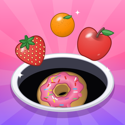
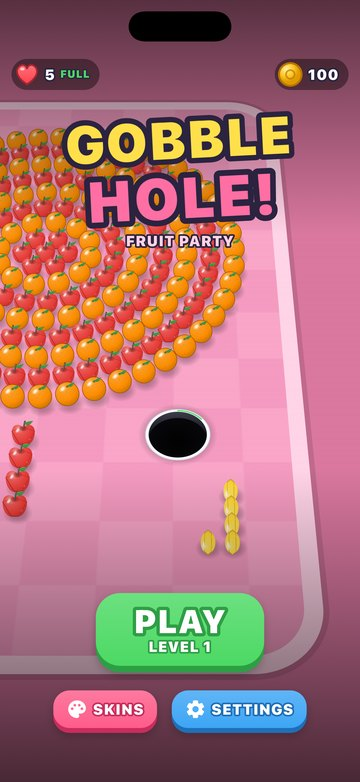
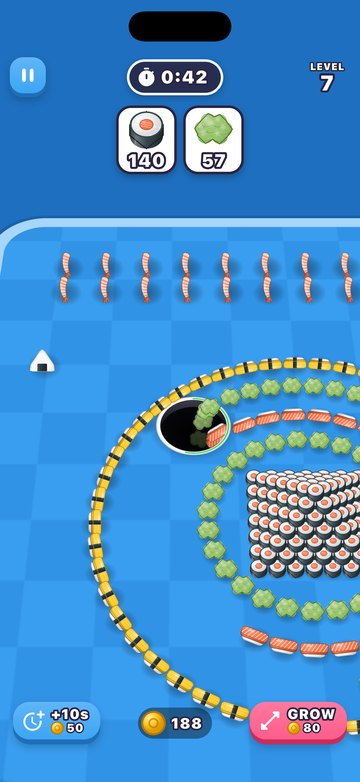
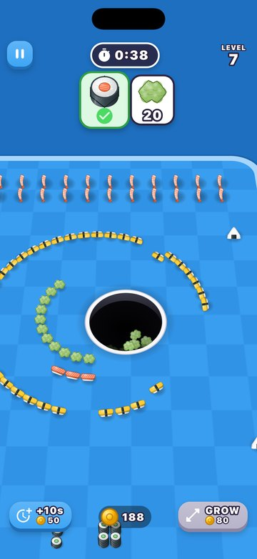
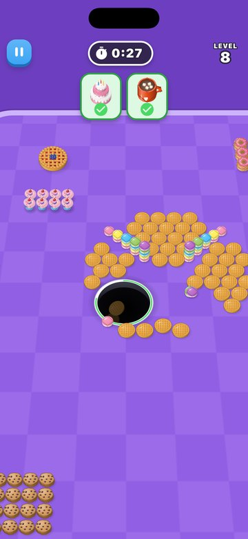
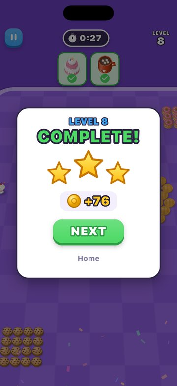
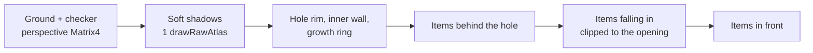

<div align="center">



# Gobble Hole

**Swallow the map, one mission at a time.**

A satisfying hole-swallowing puzzle game for iOS and Android, built with Flutter.
No game engine, and no image or audio files: every sprite and sound is generated by code.


</div>

<p align="center">
  
  
  
  
  
</p>

---

## About

You control a hole on a colourful map packed with hundreds of fruits, sweets, sushi and toys.
Drag it around to swallow everything that fits. It grows as it eats, and towers collapse
when their base disappears. Each level gives you a **mission**: swallow every item of the
shown kinds before the clock runs out.

> Gobble Hole is an unofficial fan project inspired by *Hole it!* by Supersonic Studios.
> It is not affiliated with them, and it uses none of their assets.

## Features

- 🕳️ **Physics-driven swallowing.** Items fall in only when they fit the hole. Bigger ones
  rock on the rim until you have grown enough.
- 🏗️ **Collapsing towers and pyramids.** Eat the base and everything above tumbles down,
  into the hole or onto the ground.
- 📈 **Growth.** Every bite fills the ring on the rim, the hole steps up a size, and the
  camera zooms out to match.
- 🎯 **Missions and a clock.** Goal cards at the top count down. Finish fast to earn up to
  three stars.
- 🗺️ **12 hand-made levels** across 7 themes: Fruit Party, Veggie Farm, Sweet Land,
  Sushi Bar, Toy Town, Butterfly Garden and Mint Picnic.
- ♾️ **Endless generated levels** from level 13 on. Each level number always gives the same
  map, and no two numbers give the same one, so levels never repeat.
- ⚖️ **Bot-balanced clocks.** A bot plays every level on a background isolate, and the
  level's time is derived from how long it took.
- 🪙 **Light economy.** Coins, `+10s` and `GROW` boosters, 5 lives that refill over time,
  and 6 hole skins.
- 🎨 **55 item kinds**, each drawn in Dart with `Canvas` paths and gradients.
- 🔊 **Synthesised sound effects** and haptics, both of which can be turned off.

## Getting started

Requirements: Flutter 3.41+ (Dart 3.11+), and Xcode or the Android SDK.

```bash
git clone https://github.com/SharifMuminov/gobble-hole.git
cd gobble-hole
flutter pub get
flutter run                     # on a simulator / emulator / device
flutter run --release           # smooth frame rate on a real phone
```

Build an installable Android package:

```bash
flutter build apk --release     # build/app/outputs/flutter-apk/app-release.apk
```

Run the tests (physics, level balance, and level loading on a background isolate):

```bash
flutter test
```

## How it works

### Rendering

The whole game is a single `CustomPainter`, with no game engine and no 3D library.



- The camera looks down at 52° and only ever slides, never turns. The ground and the hole
  are drawn in world coordinates under one perspective `Matrix4`.
- Every item is a billboard sprite. All 55 kinds are painted once at startup into a single
  atlas, and each frame is depth-sorted and drawn with a few `drawRawAtlas` calls, which
  keeps thousands of items cheap to draw.
- Items falling into the hole are clipped to its opening. The near rim hides them as they
  drop, and they darken with depth.

### Physics

The simulation is small and purpose-built, running at a fixed 120 Hz step. Every item is
in one of four states: `resting`, `airborne`, `sinking` or `gone`.

- **Swallowing:** a resting item that fits, with its centre well inside the opening,
  starts to sink. One near the rim slides in.
- **Stacks:** an item that loses its support topples with a small random kick.
- **Pyramids:** an item hanging over the opening also topples.
- **Growth:** thresholds are computed per level from the XP that is reachable at each
  size, so you never get stuck.

### Levels

- `LevelBuilder` lays out rings, spirals, grids, towers, pyramids, lines, and shape fills
  (heart, star, flower, butterfly).
- The hand-made levels recreate classic compositions, such as a fruit tower, a sushi
  pyramid and a sweets tower.
- The generator mixes themed palettes and features from a seed.
- The bot sets every clock: it heads for the nearest mission item it can swallow (or
  anything else, to grow), and the time limit is its result × 3.2 at level 1, easing to
  × 2.3 by level 40.

## Project structure

```
lib/
├── main.dart                 portrait lock, loads profile, sounds and sprite atlas
├── app/                      app widget, theme, PlayerProfile (saved progress)
├── game/
│   ├── constants.dart        camera pitch, physics step, gravity
│   ├── model/                ItemKind (55 kinds), Item state, HoleSkin
│   ├── engine/               camera.dart (projection), world.dart (simulation)
│   ├── levels/               builder, hand-made levels, generator, bot
│   ├── render/               item_art.dart, sprite_atlas.dart, world_painter.dart
│   └── audio/sfx.dart        sound effects (audioplayers)
└── ui/                       home, game screen, HUD, overlays, skins, widgets
tool/
├── gen_sounds.dart           synthesises assets/sounds/*.wav
├── make_icon_test.dart       draws the app icon layers
└── install_icons.py          resizes them into the iOS / Android icon slots
test/                         physics, balance, loading, and PNG render previews
```

## Tooling

| Task | Command |
|------|---------|
| Regenerate sound effects | `dart run tool/gen_sounds.dart` |
| Regenerate the app icon | `flutter test tool/make_icon_test.dart --dart-define=OUT=build/icon`<br/>`python3 tool/install_icons.py build/icon` (needs Pillow) |
| Render in-game frames to PNG | `flutter test test/scene_preview_test.dart --tags preview --run-skipped` |
| Render the item contact sheet | `flutter test test/art_preview_test.dart --tags preview --run-skipped` |
| Jump straight into a level | `flutter run --dart-define=START_LEVEL=7` |
| Let the bot play | `flutter run --dart-define=AUTOPLAY=true` |

Tune difficulty in `clockFor` in [`lib/game/levels/levels.dart`](lib/game/levels/levels.dart).

## Roadmap

- [ ] Level map with star progress
- [ ] Daily rewards
- [ ] Obstacles and special items in later levels
- [ ] More themes and item kinds
- [ ] Release signing and store builds
